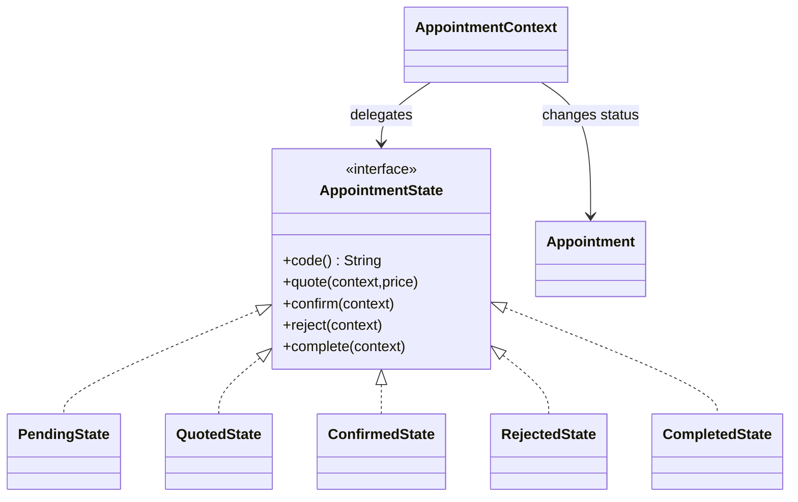
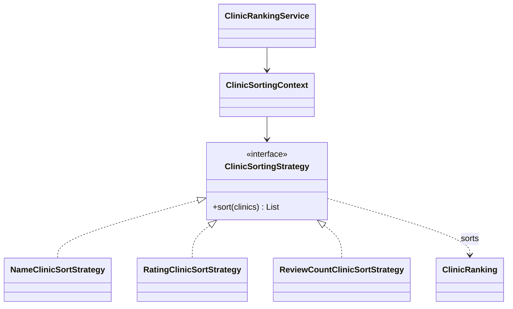
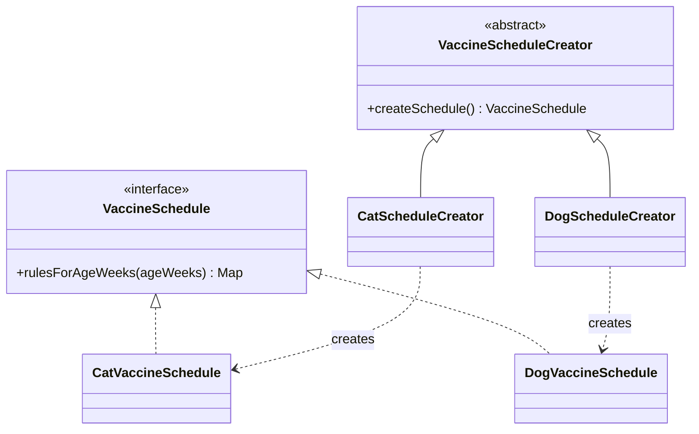
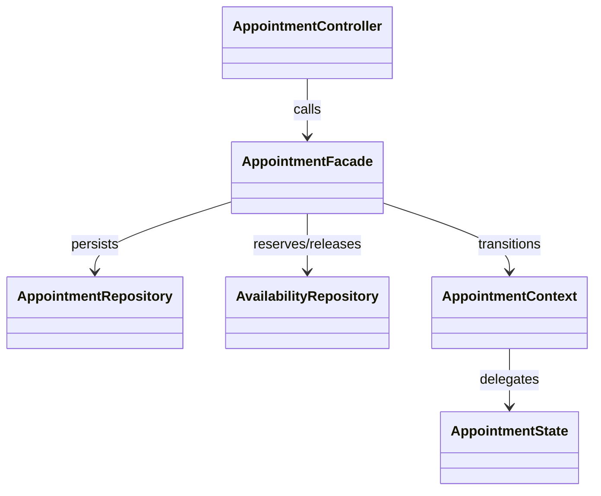

# UML Sınıf Diyagramları

GitHub, aşağıdaki Mermaid diyagramlarını gösterebilir. Dosyalardaki tam nitelikli sınıf adları `backend/src/main/java/com/example/demo/` altındadır.

## State

## Strategy

## Factory Method

## Facade

